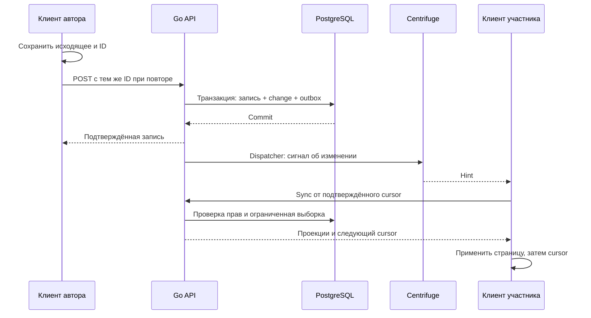

# Design

## Context

Мотивация и границы — [proposal.md](proposal.md), проверенные наблюдения —
[current-state.md](current-state.md), источники и сравнение —
[research.md](research.md). Базовый UI остаётся из согласованного
`meeting-experience-refresh`; состояния и эскизы заранее описаны в [ux.md](ux.md).

Go-монолит, PostgreSQL и memory.Store уже существуют. История смешивает
сообщения, карточки опросов/задач и системные события; доступ определяется
RSVP. Клиенты выпускаются независимо. Нельзя ввести транспорт, который
обойдёт эти правила или потребует одновременного обновления всех приложений.
При локальной разработке используются memory.Store и mock очереди;
SQL проверяется на изолированной существующей облачной БД.

27.10.2026 техническая реализация разрешена после критичных UI-исправлений;
это не свидетельство готовности кода. Подтверждены оба вида read state.
E2EE остаётся отдельным решением: этот этап сохраняет текущий серверный режим
без обещания сквозного шифрования. Подготовка и независимая приёмка ведутся
по [testing.md](testing.md). Дополнительным поручением 27.10.2026 разрешены
необходимые релизы бэкенда и миграции production-БД; магазины не затрагиваются.

## Goals / Non-Goals

**Goals:** устранить зависимость корректности от времени polling и жизненного
цикла экрана; дать измеримые гарантии восстановления, памяти и положения
ленты на каждой платформе; сохранить обратную совместимость и доступ.

**Non-Goals:** новая распределённая чат-платформа, самописная криптография,
перенос всего приложения в offline-first или единый UI SDK. Полный список
продуктовых границ — в proposal. Медиа/реакции реализуются соседним изменением,
а здесь получают общий путь upsert/invalidation и стабильные строки.

## Decisions

### 1. Готовый realtime внутри монолита

План использует Go-библиотеку Centrifuge, JS/Swift/Java SDK через адаптеры.
HTTP сохраняет команды и авторизованную выдачу истории, WebSocket доставляет
малые invalidation hints. Это дополнительный HTTP round trip, зато содержимое
всегда проходит свежую проверку доступа и существующие правила проекций.
Соединение одно на активный клиент, личная подписка плюс открытая встреча.

Собственный WebSocket потребует поддержки протокола; SSE технически подходит,
но не даёт одинакового готового lifecycle во всех выбранных клиентах.
Отдельный Centrifugo пока добавляет эксплуатацию без необходимой выгоды.
Matrix рассматривается для обязательного E2EE и потребует другого проекта
интеграции, а не замены одной зависимости. Сравнение — в research.

Первый вариант допускает ровно один API-процесс с MemoryBroker. До включения
флага проверить реальную топологию: если процессов несколько, этот вариант
не включать; отдельно выбрать общий broker/доставку по узлам и обновить план.
Rolling replacement может разорвать соединения: восстановление через БД
обязательно. Добавление узлов не объявляется поддержанным автоматически.

Версии фиксируются после короткого совместного spike: Go compatibility,
SDK auth/recovery, лицензии, SwiftPM, Android OkHttp/Gradle и размеры сборок.
Никакой установки latest без воспроизводимого lockfile. Отсутствие v1 у
библиотеки — известный риск, ограниченный адаптером и проверкой контрактов.

### 2. Постоянный журнал отделён от push

Запись истории/карточки и создание change/outbox входят в одну транзакцию.
Dispatcher работает после commit. PostgreSQL восстанавливает пропущенное,
краткое SDK recovery только ускоряет путь. Нет обещания exactly-once сети:
доставка повторяемая, применение идемпотентное. Durable outbox закрывает
сбой commit→publish, HTTP cursor закрывает пропуски получения.

Не используем NOTIFY как постоянную очередь, SDK history как БД и POST ACK
как receive cursor. Детальный порядок, reset, retention, удаление аккаунтов
и схема — [protocol.md](protocol.md). Новые порты имеют одинаковую семантику
в memory и PostgreSQL; серверные таблицы не экспортируются клиентам.

### 3. Ограниченные запросы до оптимизации инфраструктуры

Сначала keyset pagination, адресная проверка idempotency и around-окно в SQL.
Первый совместимый срез сохраняет GET feed/POST messages: receive cursor web
продвигается только по применённой GET-странице, пустой initial устанавливает
`0`, history/ACK/latest_sequence его не меняют. Это временный legacy feed cursor,
который не подменяет будущий change_cursor. Новый Reader возвращает страницы
и адресные записи; существующий полный Feed остаётся для ещё не перенесённых
потребителей (account removal/reactions). Text retry использует ключ
meeting/actor/client_request_id, media publish retry — сохранённый entry_id;
права проверяются прежде выдачи даже при существующем receipt. Memory сохраняет
clone semantics и rollback. В PostgreSQL tail и page читаются внутри текущего
repeatable-read View; существующие индексы проверяются до добавления новых.
Пустой after и uint64-границы не должны запускать полное чтение JSON-истории.
Глобальный write-lock пока не меняется: его удаление затрагивает больше
чатов и может нарушить account removal/worker. Измеряем ожидание отдельно;
при превышении бюджета выделяем изменение гранулярности блокировок.
Смена СУБД, шардинг, Redis и Kafka для этого этапа не обоснованы.

Счётчики unread и receipts — отдельные индексированные агрегаты, не загрузка
всех JSON сообщений. Их стоимость измеряется отдельно от страниц; нельзя
скрыть полный скан внутри metadata и назвать весь sync ограниченным.
Если индексированных запросов не хватает на истории 100k, до включения
вводится транзакционно обновляемая агрегатная проекция с parity-тестами.

### 4. Состояние клиента принадлежит владельцу сессии чата

Нормализованная карта записей + упорядоченные ID; отдельные границы диапазонов,
change cursor, draft/outbox, read marker и anchor. Merge/upsert не мутирует
курсор по максимальному UI sequence. Один владелец запускает сеть и fallback;
экран подписывается на его состояние. Generation/lease проверяется в ответах
всех асинхронных операций, включая дисковую очередь и read receipts.

| Платформа | Реализация и местные ограничения |
| --- | --- |
| Web | FSD: общая сессия/cursor/read DTO в entity, отправка и read-actions в features, композиция ленты в widget. SDK/IndexedDB адаптеры через допустимые слои; alias imports, только TS, arrow-функции, один небольшой компонент с props в файле. Query cache не единственный владелец outbox. |
| iOS | FeedOwner/Store владеет состоянием и effect lifecycle; адаптер SDK и storage скрыты за протоколами. Atomic file с Data Protection, ключ шифрования из Keychain, системные crypto API; не писать собственный криптопротокол. SwiftUI читает состояние, scenePhase управляет активностью. |
| Android | Repository + Flow + FeedViewModel, SDK адаптер; существующий MessageOutbox расширяется до нескольких намерений. Проверить защиту текущего файла, использовать ключ из Keystore и системный проверенный AEAD без собственного формата криптопротокола. Lifecycle прекращает фоновые соединения. |

На web draft/outbox сохраняются в IndexedDB до POST. На native — атомарное
защищённое хранение. Ошибки quota/private mode/диска не скрываются; если
запись не удалась, текст остаётся в поле. Браузер может удалить данные своего
профиля: гарантии абсолютной сохранности после очистки/eviction нет.
Холодный старт сначала проверяет аккаунт и права, затем восстанавливает
исходящие. Приватную историю на диск в этом этапе не переносим.

Две web-вкладки координируют локальную очередь через атомарное владение
записью IndexedDB и сигнал изменения/выхода. После закрытия владельца очередь
может продолжить другая вкладка; повтор всё равно безопасен по серверному ID.
Logout должен очистить общее хранилище и инвалидировать владельцев всех вкладок.

Повторы одной очереди последовательны; pending отображаются в том же timeline.
Сервер может назначить место после чужих сообщений: это корректный порядок,
но строка не пересоздаётся и viewport сохраняется. Ошибки старого исходящего
не перезаписывают новый draft. Это устраняет текущие различия трёх клиентов.

### 5. Ограниченное окно ленты с якорем

Web — `@tanstack/react-virtual` 3.14.23 (MIT), после spike бесплатного
`react-virtuoso` 4.18.19 на текущем FeedRecord. Virtuoso сохраняет малое число
DOM-строк, но удаляет сфокусированную строку при далёком скролле в Chromium и
WebKit. Его текущий API не поддерживает отдельный защищённый индекс;
[upstream issue](https://github.com/petyosi/react-virtuoso/issues/1314) остаётся
открытым. Согласованная техническая замена использует публичный
[rangeExtractor](https://tanstack.com/virtual/latest/docs/api/virtualizer#rangeextractor)
для видимого диапазона и одной отдельной focus-строки; stable keys,
measureElement и anchorTo сохраняют динамические размеры. UX/DS прежние.
Доказательства обоих spike, точные зависимости и ограничения IME проверки —
[в отчёте](qa/2026-10-28-web-window/virtualization-spike.md).
iOS/Android — существующие lazy-контейнеры со стабильными ключами и ограниченным store.
Альтернатива iOS UICollectionView допустима только если SwiftUI не проходит
проверку динамических высот/якоря; это не повод заранее переписывать экран.

Начальная страница 50, API максимум 100; нормальное окно до 500 серверных
записей и не более 200 смонтированных web-строк. Исходящие и сфокусированная
строка защищены от вытеснения и считаются отдельно. Защищённые строки не дают
бесконечно расширять непрерывное окно: при далёком переходе создаётся новое
окно, pending остаются в outbox. Вытесняется дальняя от читаемой граница.

Перед изменением измеряется `(entry_id, offset)`; после layout восстанавливается
то же место. Поздний resize карточки тоже учитывается. Изменение окна не
переключает режим следования за хвостом. Непрочитанные загружаются через around,
а не циклом из сотен страниц. Контракт UI и адаптации — в ux.md.

### 6. Read-through, а не флаг экрана

Хранение и API описаны в protocol. Пользователь подтвердил личные непрочитанные
и список прочитавших. Фактический marker и стартовая unread-база различны,
иначе миграция создаст ложное публичное прочтение. Упрощённый local boolean
не поддерживает несколько устройств и потому не используется как серверная истина.

Условия видимости: активный экран, конец сообщения виден 500 мс, нет модального
перекрытия. Read-through монотонный, запись не чаще 1/с; UI не выводит «доставлено».
Список автору строится только по текущим участникам и фактическим markers,
не по подключённым сокетам. Возврат в состав сохраняет свою прошлую позицию.

### 7. Серверное шифрование сейчас, отдельное решение для E2EE

Рекомендуемая ветка — TLS/WSS и проверенная защита хранения. Полное сравнение,
ограничения и путь Matrix при обязательном E2EE — [security.md](security.md).
Это предложение в ответ на просьбу сравнить; оно не объявлено подтверждённым
пользователем выбором. Scope разрешённого apply — исправление действующего
серверного чата с TLS/WSS, правами и защитой локального outbox, без утверждения
об отказе от E2EE. Cursor, bounded feed, sync и read state не ожидают нового
выбора стека. При отдельном выборе E2EE сначала пересматриваются затронутые артефакты.

## Risks / Trade-offs

- [Дополнительный HTTP после hint] → coalesce, небольшие страницы, отдельный
  бюджет commit→visible; при превышении сначала измерить задержку каждого этапа.
- [MemoryBroker и несколько процессов] → проверка топологии до флага,
  один процесс в этой версии, shared broker отдельным решением.
- [Журнал и read receipts увеличивают записи] → no-op не создаёт события,
  batching, retention, метрики возраста outbox и ожидания lock.
- [События удаления пересекаются с replay] → журнал ссылок без текста,
  актуальные проекции, invalidation старых диапазонов и security-тесты.
- [Виртуализация ломает focus/высоты] → реальные карточки, large text,
  keyboard/VoiceOver/TalkBack и отдельная проверка каждого клиента.
- [Браузер теряет локальные данные] → обработка quota, отсутствие ложных
  обещаний, отправка только после успешного локального сохранения.
- [Старые клиенты не отправляют read markers] → отсутствие receipt не
  выдаётся за доказательство непрочтения; совместимость явно проверяется.
- [Одновременное изменение дизайна] → сохранить согласованные компоненты
  и согласовать hook для медиа/реакций, не перезаписывать соседние артефакты.

## Migration Plan

Пользователь разрешил необходимые релизы бэкенда и миграции production-БД.
Каждый выпуск проходит проверки точного кандидата по общему процессу;
интеграционные и нагрузочные проверки остаются в изолированной базе.

1. Зафиксировать baseline/регрессии, проверить SDK и реальную топологию.
2. Аддитивная миграция и новые storage ports с parity на memory/облачном SQL.
   Старые endpoints работают; все старые writers создают change/outbox.
3. Включить журнал и базу unread под server feature flag. Инициализация
   участников атомарна с записью новых сообщений; actual read markers = 0.
4. Развернуть совместимый backend до новых клиентов; протестировать
   отключённый realtime, old clients и прокси/таймауты соединений.
5. Независимые web/iOS/Android релизы включают новую модель и transport;
   при неизвестной capability/404 используют прежний HTTP путь без read UI.
6. После совместимости и приёмки всех заявленных клиентов включать общий
   `SOMEWHERE_CHAT_READ_STATE`; отдельных серверных read-флагов по платформам
   нет. Sync дополнительно требует signing key. При ошибке выключать read/sync
   на совместимом binary и возвращаться к legacy HTTP, сохраняя signing key для
   следующего включения. Условия запуска — в
   [backend read-state](../../../backend/docs/chat-read-state.md).

Database.Check требует точный набор миграций: старый binary без миграции007
после DDL не становится ready, даже при аддитивной схеме. Поэтому rollback не
означает запуск прежнего несовместимого binary или down-миграции. История и
аддитивные таблицы/колонки сохраняются; конфигурация Git не содержит ключей.
Если отдельно согласованный совместимый rollback перестаёт писать журнал,
последующее включение требует нового stream epoch и snapshot: прежний cursor
не должен скрыть изменения за этот период.

## Open Questions

Отложены только измеряемые настройки, не продуктовые правила: точные
закреплённые версии SDK, размеры overscan/окна и параметры recovery после
пилотного замера. Начальные значения и критерии выбора уже заданы в
[validation-plan.md](validation-plan.md). Необязательный E2EE разобран как
альтернативная ветка, а не скрытый незавершённый пункт текущей реализации.
