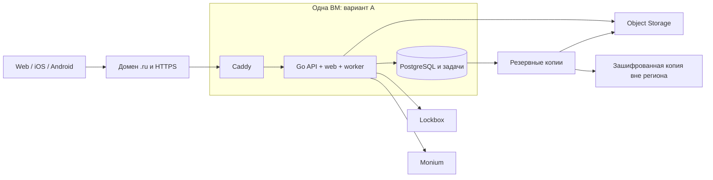
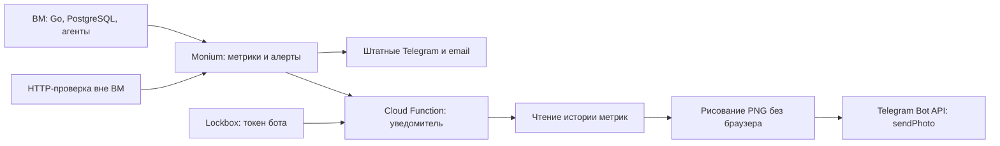

# Design

## Context

Мотивация — в [proposal.md](proposal.md), числа и источники — в
[cost-estimate.md](cost-estimate.md), публикация — в [store-release.md](store-release.md).
Оценка сделана 24.10.2026 по рабочему дереву, параллельно меняемому агентом авторизации.

Наблюдаемое состояние:

- `backend/cmd/server/main.go` создаёт `memory.New()`. Процесс хранит профили,
  сессии, встречи и задачи в памяти; готового production-хранилища нет.
- Go уже раздаёт собранный web и приглашения с серверным Open Graph;
  `SOMEWHERE_WEB_ORIGIN` и `SOMEWHERE_PUBLIC_ORIGIN` должны совпадать.
- `/healthz` проверяет процесс; для выпуска нужна отдельная готовность хранилища
  и миграций. `transition_health` уже даёт основу операционных сигналов.
- CI проверяет Go/web и мобильные проекты. iOS CI собирает simulator;
  Android `assembleRelease` ещё не подтверждает загруженный подписанный AAB.
- В iOS настроены iPhone/iPad и `dev.groupplanning.ios`; Android использует
  `dev.groupplanning.android`, target API 36. Production origin задаётся отдельно.
- Постоянные specs пока пусты; требования продукта находятся в активном изменении
  `gathering-activity-feed`. Его группа 14 остаётся владельцем постоянного хранения.

## Goals / Non-Goals

**Goals:**

- Привязать будущую конфигурацию к измеримому пилоту и стоимости, предложить
  переносимый способ выпуска общего API и независимых приложений.
- Определить проверяемые этапы сохранности, восстановления и допуска магазинов.

**Non-Goals:**

- Постоянное хранение реализуется единожды в группе 14. До выпуска приложения
  обязательны проектирование SQL/очереди, миграции и проверка сохранности.
  Пользователь разрешил развёртывание 24.10.2026; отдельный managed-кластер
  и дополнительные платные расширения не входят в выбранную конфигурацию.
- Не изменять вход, пользовательские сценарии или их текущие UX-артефакты.
- Не обещать доступность облака, одобрение магазина или HA по наличию сметы.
- UX/UI в этом техническом изменении неприменим: новые экраны не добавляются.
  Продуктовые условия публикации — зависимости отдельных изменений со своими
  `ux.md`, макетами и product-copy-editor до реализации.

## Decisions

### 1. Связь с текущим SDD

Это отдельный план, чтобы не редактировать файлы авторизации соседа.
24.10.2026 пользователь подтвердил вариант A, PostgreSQL и бюджет ниже.
Это решение заменяет прежний статус PostgreSQL как кандидата в части выбора БД;
очередь, версии и SQL-проект по-прежнему требуют 14.2. План детализирует
расчёт 14.1 и эксплуатацию/публикацию, но не
отмечает 14.1–14.5 выполненными. Перед apply сопоставить актуальные решения:

| Группа основного изменения | Результат этого плана |
| --- | --- |
| 14.1 Нагрузка/стоимость | Смета A/B/C, предварительные цели, сценарий измерения |
| 14.2 Выбор хранения/очереди | Учесть принятые A и PostgreSQL; выбрать очередь, версии и SQL-проект |
| 14.3 Адаптеры/миграции | Обязательная зависимость deployment, одна реализация без дублирования задач |
| 14.4 Сохранность/мониторинг | Дополнение приёмки: restore drill, алерты, метрики и стоимость |
| 14.5 Итоговая приёмка | Отчёт целевого окружения + отдельные отчёты магазинов |

Завершение этой подготовки не меняет порядок функциональной разработки на моках.

### 2. Принятая конфигурация A для MVP

Одна обычная ВМ Intel Ice Lake 2 vCPU 50% / 4 ГБ RAM, SSD 40 ГБ, IPv4, Linux;
Caddy → Go API/web;
PostgreSQL на том же узле, worker в Go-процессе. Сетевой доступ к PostgreSQL
только локально; Go слушает loopback. Внешние входящие 80/443, SSH ограничен
административным адресом; приложение работает от непривилегированного пользователя.
50% — гарантированная доля каждого vCPU, не два полных ядра. Это выбранная
стартовая конфигурация, её вместимость предстоит измерить. Бюджет —
5 000 ₽/месяц с резервом, включая домен и платежи магазинов в месячном эквиваленте.
Развёртывание разрешено пользователем 24.10.2026; создание ресурсов выполняется
после проверки доступности и плана. Само создание ВМ не закрывает допуск к пилоту.

Альтернатива B выносит PostgreSQL в managed-сервис за доплату около 6,4 тыс. ₽/месяц,
сохраняя размер ВМ приложения и её диск на время перехода.
Она уменьшает ручную работу с БД, но один хост не даёт автоматической защиты от
всех сбоев. C оценивает рост и два хоста БД, сохраняя оговорку об одном API-узле.
Полная отказоустойчивость — отдельное решение по результатам наблюдения.

Serverless Containers не выбраны для первого переноса: текущий постоянно
работающий worker и память требуют другой модели исполнения/хранения.
Kubernetes и микросервисы не обоснованы пилотом из шести человек.
Статический S3-hosting отдельно от API усложняет существующий same-origin и
динамический preview; текущую раздачу Go проще сохранить.

### 3. Выбранное хранилище и открытый выбор очереди для 14.2

Хранилище — PostgreSQL. Первоначальный кандидат очереди — открытая версия River: общая транзакция для предметной
операции и постановки задачи позволяет обойтись без отдельного брокера.
[River](https://github.com/riverqueue/river). Лицензии/совместимые версии фиксируются
при выборе; платные расширения в расчёт не входят.

| Кандидат | Компромисс |
| --- | --- |
| PostgreSQL + River | Один постоянный движок и готовые механизмы очереди; проверить, как перенести существующие lease/retry/scheduleVersion без двойной логики |
| PostgreSQL + собственная таблица задач | Сохраняет знакомую модель, но требует самостоятельно поддерживать SQL-конкуренцию, retries и обслуживание |
| PostgreSQL + Message Queue | Дополнительный сервис и транзакционный outbox для согласования записи БД и отправки; для пилота нет подтверждённой выгоды |

Данные identity, сессии/отзывы, receipts, сообщения, ревизии, сроки и версии
задач должны перейти в постоянные адаптеры. Серверные модели БД остаются внутри
backend; HTTP DTO и `/api/v1` сохраняются. Точная схема, индексы, уровни изоляции,
миграции и версии — результат 14.2 перед кодом 14.3, не скрытая реализация этого плана.
Для переноса в managed-сервис сразу отделить DSN, TLS/CA и размер пула от кода,
выбрать поддерживаемую там версию PostgreSQL и проверить необходимые расширения.
Runtime работает без superuser; обязательные задания не зависят от локальных
файлов сервера БД. Смена размещения не должна менять HTTP API и мобильные приложения.

При переходе к реализации 24.10.2026 выбраны PostgreSQL 16, pgx v5.11.0
и собственные SQL-записи существующих `TransitionJob`/`PollCloseJob`.
Обоснование, модель таблиц, транзакции, миграции и критерии адаптера записаны
в [проекте хранения для 14.2](storage-design.md). Реализация адаптеров и проверки
на реальной БД остаются открытыми; River не устанавливается.

### 4. Выпуск и секреты

Собирать Go binary и web dist из одного commit, сохранять checksum и release
manifest. На ВМ версионированные каталоги и systemd; переключение на новую
версию сопровождается readiness и коротким сквозным smoke-test. Хранить
предыдущий совместимый артефакт. Контейнерный registry для этого не требуется.

Конфигурация инфраструктуры и несекретные параметры воспроизводимы в Git;
state IaC и секреты закрыты. Lockbox: отдельные версии конфигурации OAuth,
БД и служебных секретов, доступ через service account с узкими правами.
Не сохранять долгоживущий облачный ключ прямо на ВМ, не включать секреты в
frontend или мобильный binary. Ротация учитывает сохранение действующих сессий.

Выбран `smwhere.ru`, продукт сохраняет имя somewhere. `somewhere.ru` занят;
24.10.2026 WHOIS не обнаружил регистрации `smwhere.ru`. Окончательная доступность
подтверждается оформлением заказа. Домен покупает пользователь на своём аккаунте,
DNS остаётся у регистратора, TLS автоматически
выдаётся и продлевается Caddy. Проверить открытие 80/443 и продление:
[Caddy automatic HTTPS](https://caddyserver.com/docs/automatic-https).
Фактические callback/SDK-настройки взять из результата работы по авторизации;
не придумывать новые маршруты и не менять механизм входа в рамках деплоя.

### 5. Сохранность и целевые показатели

Рабочие цели приёмки пилота; подтвердить испытаниями в 14.1–14.4:

| Показатель | Пилот |
| --- | --- |
| API | p95 ≤ 500 мс серверной обработки чтений/записей; внешние OAuth/файлы отдельно |
| Ошибки | 5xx < 1% за 15-минутный тест 5 запросов/с, без намеренно внесённых сбоев |
| Задачи | p95 задержки ≤ 60 с при нормальной работе; окончательная ошибка сигнализируется |
| Доступность | Внутренняя цель 99,5% за 30 дней, без договорного SLA; измерить, не объявлять достигнутой |
| Копии | Ежедневно; целевой RPO ≤ 24 ч, RTO ≤ 8 ч после потери узла, включая реакцию владельца |
| Наблюдение | Первые 7 дней фактического пилота; availability оценивать на полном окне 30 дней |

Копии БД вне ВМ, retention и объём по смете; ежедневный зашифрованный экспорт
вне облачного региона на существующее устройство владельца. Проверка восстановления
в чистую БД обязательна, включая профили/сессии, права, receipts и пропущенные
задачи. [PostgreSQL: согласованный dump](https://www.postgresql.org/docs/current/backup-dump.html).
Цели пересмотреть при недостаточной доступности оборудования владельца.

Метрики: latency/error rate по операциям и модулям, CPU/RAM/disk, соединения/задержки
БД, возраст успешной копии, задержка/окончательные ошибки/lease задач и сверка
просроченных встреч. Не использовать user/meeting/token как метку высокой
кардинальности. Определить получателя сигналов; проверить доставку тестовым сбоем.
Порог бюджета 50/80/100%, включая прогноз. Budget alert не является жёстким
лимитом расходов. Конкретные сигналы, периоды и действия приведены ниже.

#### Как измерить RPS

Ни 5, ни 20 RPS пока не измерены. Базовый допуск: 5 RPS в течение 15 минут,
всплеск 20 RPS на 60 секунд и возврат к обычной нагрузке без потери операций.
На временном окружении того же размера выполнить ступени 5 → 10 → 20 → 50 RPS
по 15 минут, останавливая повышение при нарушении целей. Наибольшую прошедшую
ступень повторить 60 минут, включая worker и один цикл копирования. Если все
ступени прошли, результат — «не менее 50 RPS в этом сценарии», а не найденный предел.

Воспроизвести смесь 80% чтения списка/ленты и 20% записей сообщений/RSVP/задач,
несколько встреч и горячую общую встречу, до 2 ГБ подготовленных данных.
Уточнить смесь по фактическим клиентам, включить polling и служебные запросы;
RPS считается суммарно по API, а не только по нажатиям пользователя.
Генератор нагрузки находится вне ВМ приложения. Использовать обычные тестовые
сессии; внешний OAuth не подвергать нагрузочному тесту. Отдельно записать
latency генератора и серверную, p95 по операциям, 5xx/таймауты, задержку задач,
CPU/RAM, I/O и ожидание соединений БД. Отчёт задаёт рабочую нагрузку с запасом
30% относительно подтверждённой устойчивой ступени. Тест на memory.Store
не подтверждает вместимость PostgreSQL.

### 6. Условия перехода на управляемую PostgreSQL

Владелец проекта проверяет показатели еженедельно первый месяц, затем ежемесячно
и после каждого инцидента. Следующие пороги — правила нашего проекта, а не
ограничения PostgreSQL или SLA провайдера. Число регистраций само по себе не триггер.

| Основание | Измеримый порог | Действие |
| --- | --- | --- |
| Обслуживание отнимает время | Более 2 часов в неделю две недели подряд на обновления БД, копии и восстановление; без разработки функций/SQL | Запланировать переход на managed для сокращения ручного обслуживания |
| Повторяющиеся инфраструктурные сбои БД | Не менее двух инцидентов за 30 дней с суммарным простоем от 60 минут, причиной которых стали узел/эксплуатация БД | Запланировать managed с проверкой, какие причины устранит выбранная топология; ошибки SQL разбирать отдельно |
| Нужна лучшая сохранность/доступность | Потребовались RPO <24 ч, RTO <8 ч или автоматическое переключение; либо испытание/инцидент превысил текущий RPO/RTO | Спроектировать подходящий managed-кластер и провести restore/failover до обещания новых целей |
| Некому обслуживать БД | Нет назначенного человека, способного отреагировать и восстановить БД в пределах RTO | Перенести эксплуатацию БД в managed до такого периода, сохранив ответственного за приложение |
| База конкурирует с приложением | После исправления запросов/индексов в 3 разных дня за 7 дней остаются 15-минутные нарушения p95 >500 мс или задержки задач >60 с; диагностика связывает их с ресурсами общей БД/ВМ | Сравнить увеличение ВМ с выделением managed; выбрать перенос, если нужна независимая ёмкость БД или увеличение ВМ не возвращает запас |

При срабатывании первых четырёх оснований в течение 7 календарных дней подготовить
отдельное OpenSpec-изменение перехода: данные инцидента/учёта времени, топология,
актуальная смета, владелец и дата переноса. При нарушении сохранности сначала
устранить инцидент; 7 дней — срок планирования, не разрешённый простой.
Если managed не устраняет причину, зафиксировать альтернативную меру и дату
повторной проверки. Платные ресурсы не создаются автоматически по алерту.

CPU >70% гарантированного ресурса или RAM >80% в течение 15 минут,
диск >70% либо прогноз заполнения менее чем за 30 дней — ранние сигналы
разбора ёмкости. Они запускают диагностику в ближайшие 2 рабочих дня, но сами
по себе не требуют managed. До исчерпания диска расширить ёмкость/очистить
безопасные временные данные; ждать миграции для устранения аварии нельзя.

Для экономии времени допустим один managed-хост (B). Для автоматического
переключения нужны несколько хостов по зонам, параметры репликации и тест отказа.
Один managed-хост не даёт высокой доступности; доступность API с одной ВМ
остаётся отдельной проблемой. Для меньшего RPO проверить PITR и задержку архивации
WAL; для меньшего RTO — реальное восстановление, квоты и время реакции приложения.
Источники: [копии и PITR](https://yandex.cloud/ru/docs/managed-postgresql/concepts/backup),
[репликация](https://yandex.cloud/ru/docs/managed-postgresql/concepts/replication),
[топология при создании](https://yandex.cloud/ru/docs/managed-postgresql/operations/cluster-create).

### 7. Независимые клиенты и магазины

Web: production dist и общий origin; deep-link reload, `/i/` и прежние приглашения,
Open Graph без JS, cookies/CSRF и HTTPS проверяются через внешний адрес.

iOS: действующая команда/Bundle ID, production origin и SDK-конфигурация,
device archive, TestFlight, проверки iPhone/iPad, затем App Store. Android:
application ID, ключи и fingerprints, AAB для Play, APK для RuStore, проверка
SDK-входа именно с магазинной подписью, закрытое тестирование и review.
Пошаговая процедура и публичные условия — в [store-release.md](store-release.md).

Новые экраны не добавляются. Удаление аккаунта, модерация и применимость
альтернативного входа Apple — отдельные зависимости публичного запуска.
Если они меняют API, должны включать совместимость старых поддерживаемых сборок.
Допуск фиксируется по платформам; успех web или одного магазина не закрывает остальные.

### 8. Мониторинг в Yandex Cloud

Базовый план: Monium хранит метрики/логи, показывает панели и вычисляет алерты
вне ВМ приложения. Отдельные Prometheus, Loki и Grafana для старта не требуются.
Ресурсные метрики Compute поступают автоматически; занятые RAM/файловая система
видны только из гостевой ОС. На Linux установить Unified Agent для системных
метрик и локальных Prometheus-endpoints Go/экспортера PostgreSQL. Для логов
использовать OpenTelemetry Collector: Unified Agent сейчас поддерживает только
метрики. Экспортеры слушают loopback, роль чтения статистики БД ограничена.
Не публиковать `/metrics` и порт экспортера в интернет.

Источники: [обзор Monium](https://yandex.cloud/ru/docs/monium/overview),
[системные метрики Linux](https://yandex.cloud/ru/docs/monium/operations/unified-agent/linux_metrics),
[справочник Compute](https://yandex.cloud/ru/docs/monitoring/metrics-ref/compute-ref),
[справочник агента](https://yandex.cloud/ru/docs/monium/metrics-ref/unifiedagent-ref).

Поставка раз в 60 секунд, до 500 активных пользовательских временных рядов
с учётом всех меток и histogram buckets; до 5 ГБ логов/месяц и 20 вычисляемых
условий алертов. Это бюджетные рамки, проверить фактическую кардинальность.
При нагрузочном испытании временно 15 секунд, стоимость пересчитать.
Для агентов начать с суммарного лимита памяти 384 МиБ и ограниченного дискового
буфера 256 МиБ; проверить отсутствие потерь/задержек, затем уточнить лимиты.
Затраты агентов входят в общие 4 ГБ ВМ и в нагрузочное испытание.
Логи хранить 14 дней, без тел запросов, токенов, email, invite URL и raw SQL.
Трейсы и высокую кардинальность не включать автоматически.

Четыре панели: «Обзор» (доступность, RPS, p95, 5xx, задачи), «ВМ» (CPU/RAM,
сеть, место и I/O), «PostgreSQL» (соединения, ожидания, размер, транзакции,
копии), «Эксплуатация» (возраст телеметрии, ошибки агентов, расходы и инциденты).
Окна 1 ч / 24 ч / 7 дней / 30 дней; отметки релизов и нагрузочных тестов.
Конфигурации запросов, дашбордов, порогов и каналов сохранить в Git без секретов.

#### Что измеряем и когда уведомляем

Ниже начальные пороги проекта. После 7 дней пилота пересмотреть шум и нормальный
уровень; каждое изменение сохранять с причиной. `Warning` означает необходимость
разобраться, `Alarm` — проблему, требующую реакции. Срабатывание по устойчивому
окну, восстановление после 5 минут нормы. Отсутствие данных не равно нулю.

| Область | Метрики/смысл | Начальное правило |
| --- | --- | --- |
| CPU | Compute `cpu_usage`, по ядрам `cpu_utilization`; гостевые steal/iowait/load | Warning: >70% гарантированного ресурса 15 мин; Alarm: >90% 10 мин. `cpu_usage` может быть >100% при использовании свободного ресурса; не сравнивать его напрямую с гостевым % без нормализации |
| RAM | `1 − MemAvailable / MemTotal`, swap, OOM/restarts | Warning: >80% 15 мин; Alarm: >90% 5 мин или OOM. Page cache сам по себе не утечка |
| Место | Used/Size и свободные байты для `/` и каталога БД, inodes | Warning: >70% 15 мин или прогноз заполнения <30 дней; Alarm: >85%, свободно <5 ГБ либо inodes >90% 5 мин |
| I/O диска | Read/write bytes/s, IOPS, latency, `disk.io_quota_utilization_percentage`, throttler delay | Warning: квота I/O >70% 15 мин; Alarm: >90% 10 мин или ошибки I/O. Это отдельно от свободных гигабайт |
| Сеть | RX/TX bytes/s, packets/s, drops/errors, квота соединений | Warning: >70% проверенного лимита полосы/соединений 15 мин; Alarm: >90% 10 мин либо доля drops/errors >1% 5 мин при ≥100 пакетах/мин. RX+TX и месячный egress показывать отдельно |
| API снаружи | HTTPS-запрос к readiness раз в минуту с отдельной Cloud Function | Alarm: 3 последовательных неуспеха; отсутствие результатов >3 мин — отдельная неисправность проверки |
| API поведение | RPS, p95 по операциям, 5xx/таймауты | Warning: p95 >500 мс 15 мин; Alarm: 5xx/таймауты >1% 5 мин при ≥100 запросах в окне. При меньшем трафике — 3 последовательных неуспеха внешней проверки |
| PostgreSQL | Доступность, размер, pool wait, соединения/max, lock wait, deadlocks, long transactions | Alarm: БД недоступна 2 мин; Warning: соединения >80% 10 мин или блокирующая транзакция >60 с. Планы медленных запросов исследовать локально без отправки параметров в Telegram |
| Worker | Задержка задач, final failures, зависшие lease, последний успешный reconcile | Warning: p95 задержки >60 с 5 мин; Alarm: final failure либо отсутствие успешной сверки дольше двух её интервалов |
| Копии | Время последней успешной копии и внешнего экспорта, последний restore drill | Alarm: ошибка копирования либо возраст копии >25 ч. Проверка restore до запуска, затем ежемесячно и после смены схемы/версии/способа копирования |
| Сам мониторинг | Последняя точка, потери/ошибки агента, ошибки функции | Alarm: свежих данных нет >3 мин; при отсутствии метрик нельзя рисовать нормальную нагрузку или закрывать инцидент |

Сетевую скорость сравнивать с лимитом конкретной ВМ/интерфейса после его проверки;
не задавать произвольный «опасный Мбит/с». Фактический биллинг трафика проверять
в Billing, интеграл TX на панели — диагностическая оценка. Из общего бюджета
5 000 ₽ в первый год 1 050 ₽ резервируется на домен/магазины; для облака остаётся
3 950 ₽. В Billing настроить сигналы 50/80/100% этого облачного лимита и прогноз,
без автоматического выключения; внешний годовой резерв учитывать отдельно.
Алерты группировать по узлу и причине, не более 20 одновременно вычисляемых
условий в исходной смете; превышение или мультиалерты требуют пересчёта.

Внешняя HTTP-проверка живёт вне ВМ: начальная конфигурация 256 МиБ, один запуск
в минуту, ожидаемое среднее время ≤2 с. Публикует результат и latency в Monium.
Её холодный старт/таймаут отличать от отказа приложения. Проверка из того же
облака не доказывает доступность при региональной аварии; для такой цели
потребуется независимый внешний наблюдатель и отдельный расчёт.

#### Каналы и возможный Telegram-бот с графиками

Сначала настроить штатные Telegram и email-каналы Monium: сообщения при
`Warning`/`Alarm`/`No data`/`Error` и восстановлении; повтор критичного состояния
раз в 30 минут. На согласованных технических работах подавлять только ожидаемые
сигналы на ограниченный срок. У штатного канала документация явно обещает
скриншот для Яндекс Мессенджера; такую возможность Telegram не предполагать.
[Каналы Monium](https://yandex.cloud/ru/docs/monium/concepts/alerting/notification-channel).

Возможное расширение, которое пока только спроектировано:

Функция не зависит от Go API и PostgreSQL приложения: их отказ не должен
мешать уведомлению. Канал Cloud Function вызывает закрытую функцию асинхронно.
Документированный вход: `alertId`, `alertName`, `labels`, `folderId`,
`alertStatus`, `annotations`; `folderId` в событии может быть пустым.
Идентификатор каталога/проекта брать из конфигурации, а не доверять событию.
Время события добавить аннотацией, если это поддерживает выбранный тип правила;
иначе явно подписывать время получения события и не выдумывать время начала.
[Интеграция с функцией](https://yandex.cloud/ru/docs/monium/operations/alert/create-channel-function).

Технический поток:

1. Проверить allowlist alert ID, окружения и технических меток. По локальному
   каталогу правил выбрать до четырёх рядов, единицы, пороги, ссылку на панель
   и короткую инструкцию. Произвольные запросы/URL из уведомления не выполнять.
2. Получить 60 минут истории с шагом 60 секунд через документированный MetricsData
   API. Для folder-метрик это `POST /monitoring/v2/data/read` с `folderId`,
   `query`, `fromTime`, `toTime`, `downsampling`. Проверить совместимость
   селектора с реально настроенной моделью Monium; не смешивать её с PromQL
   воркспейса. [API чтения](https://github.com/yandex-cloud/docs/blob/master/md-docs/monium/api-ref/MetricsData/read.md).
3. На Go построить PNG, например 1200×700, с линией порога, временем, единицами
   и пропусками данных. Выбор/версию библиотеки графиков закрепить при реализации.
   Это изображение метрик, а не скриншот интерфейса Monium или Grafana.
4. Отправить `sendPhoto` multipart в заранее разрешённый `chat_id`; подпись:
   состояние, узел, значение/порог, окно, время и первое действие. Кнопка ведёт
   на закрытую панель. Сохранять картинку публично в S3 не нужно; размер ≤1 МБ,
   подпись ≤900 символов — наши ограничения внутри лимитов Telegram.
   [Telegram Bot API](https://core.telegram.org/bots/api#sendphoto).
5. При отсутствии истории/сбое рендера отправить `sendMessage` с причиной
   отсутствия графика. Сбой дополнительной функции не отключает штатные каналы.
   На 429 учитывать `retry_after`, на временные ошибки — ограниченные повторы;
   лимит 30 с на вызов и не более 3 попыток. Долгое ожидание не держит функцию:
   завершить неуспехом, использовать ограниченные асинхронные повторы.

Начальный вариант функции stateless: повторы регулирует канал Monium,
повторная доставка может дать дубль. Гарантию exactly-once не заявлять.
В сообщения включать alert ID/состояние/время, чтобы дубли были узнаваемы;
проверить отсутствие лавины при 20 одновременно сработавших условиях.
В Cloud Functions настроить пределы параллелизма/повторов, длительность и
метрики неуспешных вызовов. Суточная тестовая доставка подтверждает работу пути.
Новый бот создаётся владельцем через BotFather; он начинает диалог/добавляет
бота в закрытую группу. Входящий webhook и команды управления в первый вариант
не входят: бот только отправляет технические уведомления.

Токен — отдельная версия Lockbox; сервисному аккаунту функции только чтение
нужных метрик и конкретного секрета. Аккаунт канала имеет права вызова функции,
не чтения токена. Не логировать HTTP URL Telegram с токеном, заголовки и payload
секретов. В PNG нет пользовательских данных. Тесты: Alarm/OK/No data, нет метрик,
запрет доступа, ротация токена, 429, сбой рендера, одновременные и повторные
события, остановка ВМ/БД. Сервисные аккаунты и реальные сообщения сейчас не создаются.

#### Если понадобится Grafana

Grafana OSS можно разместить на отдельной ВМ Yandex Cloud. Для первого приближения:
2 vCPU 50%, 4 ГБ RAM, SSD 20 ГБ; HTTPS, закрытый доступ, без anonymous/admin по
умолчанию, provisioned dashboards/datasources и резервная копия конфигурации.
Не ставить её вместе с PostgreSQL на стартовые 4 ГБ. Не использовать прикладную
БД как единственную зависимость мониторинга; metadata Grafana резервировать отдельно.
[Ресурсы Grafana](https://grafana.com/docs/grafana/latest/setup-grafana/installation/).

Документированный путь интеграции — Prometheus data source → read endpoint
воркспейса Yandex Managed Service for Prometheus; туда агент поставляет
выбранные метрики через remote write. Native Compute-метрики не возникают
в таком воркспейсе автоматически: потребуется экспорт/маппинг либо отдельный
совместимый источник; чтение/повторная запись учитываются в смете. Проверить
поддержку конкретного режима аутентификации, ротацию и версии на стенде.
Доступ к метрикам только на чтение; не копировать в Git ключ сервисного аккаунта.
[Интеграция Prometheus/Grafana](https://yandex.cloud/ru/docs/monium/operations/prometheus/).

Для **настоящих скриншотов Grafana**: отдельный Image Renderer service,
связь правила с dashboard UID/panel ID, `unified_alerting.screenshots.capture=true`
и Telegram contact point. Grafana умеет прикладывать снимок к Telegram сама;
собственный код бота для этого не обязателен. Зафиксировать поддерживаемые версии,
секрет renderer, лимит параллельного рендера 1 и проверить доставку при его отказе.
PNG передавать вложением, без публичного бакета. Этот путь использует правила
Grafana; изображение не появляется автоматически у алерта, вычисленного Monium.
Не дублировать основной пейджинг; штатный канал Monium оставить как резервный.
[Изображения в уведомлениях](https://grafana.com/docs/grafana/latest/alerting/configure-notifications/template-notifications/images-in-notifications/).

Официальный ориентир renderer — 4 CPU и 16 GiB RAM; это рекомендация для
сервиса рендера, не минимальная память самой Grafana. При меньшем размещении
нужны отдельные замеры Chromium и допустимого параллелизма. Такой стек сейчас
избыточен для бюджета MVP; расходы сравниваются в смете.
[Image Renderer](https://grafana.com/docs/grafana/latest/setup-grafana/image-rendering/).

## Risks / Trade-offs

- [Ограничения Yandex Cloud] → Проверить статус и квоты до покупки. При отсутствии
  ресурсов отложить запуск или отдельно выбрать и пересчитать другую площадку;
  Россия остаётся целевым регионом оценки, Казахстан автоматически не подставляется.
- [Одна ВМ и ручная эксплуатация] → Принять ограничения пилота, проверить копии,
  иметь владельца восстановления; при росте рассмотреть B/C.
- [Память вместо БД сейчас] → Не допускать реальные сохраняемые данные до 14.3–14.4.
- [Тарифы и валюта] → Перед оплатой обновить смету, резервировать 5 000 ₽/месяц
  для A; комиссии способов оплаты не считать известными без инвойса.
- [Шесть друзей меньше Google minimum] → Набрать не менее 12 тестировщиков
  для нового личного аккаунта, учитывать 14 дней и проверку заявки.
- [Требования Apple к стороннему входу] → Проверить применимость правил/исключений,
  при необходимости отдельное изменение входа, без вмешательства в текущую работу.
- [Модерация ещё не спроектирована] → Смета относится к инфраструктуре пилота;
  перед публичным релизом добавить выбранные платные средства и трудозатраты.

## Migration Plan

### Первый запуск

1. Завершить функциональные сценарии на моках и результаты авторизации.
2. Проверить доступность выбранной конфигурации Yandex Cloud и актуальность сметы; выполнить
   проектирование хранения 14.2, затем 14.3–14.4. Развёртывание не начинает их раньше.
3. В пустом временном окружении проверить миграции и перезапуски; перенос текущих
   memory-данных не обещается. Проверить restore и совместимость старого binary
   с новой схемой. Деструктивные миграции не совмещать с первым переключением.
4. После разрешения на размещение настроить домен/TLS, secrets, выпуск и алерты,
   провести smoke/load/restore на целевой конфигурации и ограниченный пилот.
5. Подготовить signed mobile candidates и пройти тестовые каналы. Публичный
   выпуск — после независимых продуктовых зависимостей и допусков магазинов.
6. При провале readiness вернуть предыдущий совместимый binary; при несовместимой
   схеме применять заранее испытанный recovery plan. Восстановление старой копии
   с потерей новых данных не выполнять автоматически. Для mobile остановить
   rollout и выпустить исправление, поддерживая установленные клиенты.

### Будущий перенос PostgreSQL после срабатывания условий

Это условный план следующего изменения; выполнить перенос для завершения MVP
не требуется. Подготовка переносимой конфигурации и регламента входит в текущие задачи.

1. В отдельном изменении закрепить причину, цели RPO/RTO, число хостов/зоны,
   версии/расширения, смету и окно работ. Добавить IaC для managed-кластера,
   приватных подсетей/групп доступа, пользователей, backup/PITR, maintenance
   и защиты от удаления. При переходе ради доступности отдельно решить судьбу
   единственной API-ВМ; один дополнительный хост БД весь сервис HA не делает.
2. Подготовить TLS с проверкой CA/имени хоста, managed endpoint и секреты,
   лимит соединений, timeouts/reconnect и повтор только безопасных операций.
   Перевести панели/алерты на новый ресурс; оставить внешний экспорт копий.
3. Репетировать dump/restore на копии, проверить роли, extensions, sequences,
   миграции, сессии, receipts, очередь/lease и сквозные сценарии клиентов.
   Если измеренное время не помещается в окно — отдельно спроектировать
   репликацию/Data Transfer; не обещать бесшовный перенос по умолчанию.
4. В окно работ остановить новые записи, cron/reconcile и worker, дождаться
   транзакций и освобождения lease, сделать финальную согласованную копию.
   Восстановить managed-БД и сверить количества/контрольные суммы/инварианты.
   Старую БД защитить от записи; одновременно двух источников истины нет.
5. Переключить конфигурацию, readiness и smoke-test, затем разрешить записи
   и единственный набор worker. Домен/API не меняются, клиенты не перевыпускаются
   ради переноса. Измерить простой, p95 и сохранность, проверить копию/PITR
   и failover, если он входит в выбранную конфигурацию.
6. До первой новой записи откат — возврат к замороженной исходной БД.
   После новых записей простой возврат DSN запрещён: нужна новая пауза записи
   и проверенный обратный перенос всех подтверждённых данных либо исправление
   на managed. Старую копию сохранить закрытой минимум 7 дней и до успешной
   проверки восстановления новой БД; затем убрать старый сервис/доступы.
   Диск ВМ автоматически не уменьшать; экономию ресурсов рассматривать отдельно.

## Open Questions

Перед размещением можно заполнить без изменения структуры плана:
подтверждение покупки `smwhere.ru`, ID аккаунтов/Team, дата и валюта продления Apple,
получатель алертов и конкретные 12 тестировщиков. Секреты в эти документы не добавлять.
Конфигурация A, PostgreSQL и бюджет 5 000 ₽/месяц приняты 24.10.2026;
проект PostgreSQL/очереди для 14.2 зафиксирован в storage-design.md;
миграции и адаптер ещё предстоит реализовать и проверить.
Monium — проект базового мониторинга; бот и Grafana — варианты расширения,
не уже работающие сервисы.
