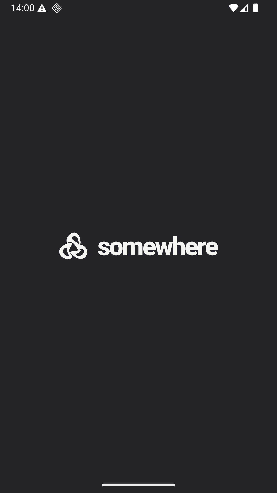

# Проверка основы Android · 7.1

21 октября 2026 года. Проверен минимальный Compose target; API, сессия и
пользовательские экраны относятся к следующим задачам. За основу взят
[android-bootstrap.md](android-bootstrap.md), дизайн v0.7 и существующий знак.

## Сборка

Локально: macOS arm64, JDK 17.0.6, Gradle wrapper 8.14.3, AGP 8.13.1,
Kotlin/Compose compiler 2.2.20, SDK 36 и Build Tools 36.0.0.
Из frontend/android выполнена команда `sh scripts/check.sh`:

- clean и formatCheck: успешно; ktlint проверяет Kotlin и Gradle Kotlin DSL;
- assembleDebug и assembleRelease: успешно, включая R8/resource shrinker;
- lintDebug и lintRelease: нет ошибок и предупреждений;
- testDebugUnitTest: NO-SOURCE. Unit-тестов пока нет, логика появится в 7.2.

Lint сохраняет информационные уведомления об обновлениях зависимостей.
Ошибки API-совместимости, иконки и резервного копирования исправлены;
подавлений и baseline для ошибок кода нет. Стек закреплён намеренно,
обновление версий требует отдельной проверки совместимости.
Gradle сообщает, что libandroidx.graphics.path.so упакована без stripping;
это библиотека Compose, APK успешно собраны. Release остаётся unsigned.

## Запуск

Использован **один** существующий Pixel_XL_API_36 / emulator-5554, API 36 arm64.
Новый AVD не создавался; приложение установлено через adb install -r.
Холодный запуск MainActivity завершился Status: ok; системный Back и повторное
открытие — Status: ok. Журнал crash пуст, процесс остаётся живым.
Фирменная подпись помещается в портретный экран, знак слева, фон и текст
совпадают с общей палитрой. Системные панели не перекрывают контент.

По замечанию пользователя исправлена системная заставка Android 12+: исходный
вектор растягивался до размера системной области и обрезался круглой маской.
Отдельный inset drawable уменьшает видимый знак примерно до 46 dp.
Повторный холодный запуск записан и проверен покадрово: знак целиком виден,
затем появляется корневой экран с названием. Повторный check.sh после правки
также завершился успешно. [Запись запуска](assets/android-bootstrap/startup.mp4).

## Границы

Снимок показывает технический корневой экран, не завершённый онбординг.
На устройстве проверен Debug; Release собран и проверен Lint, но не установлен.
API 26 проверен статически Lint, отдельное устройство для него не запускалось.
TalkBack, масштабирование, реальная авторизация и сценарии встреч ещё не проверены.
Движение знака и переход к онбордингу появятся вместе с состоянием загрузки в 7.4.

GitHub Actions настроен на тот же check.sh; результат локального запуска
не подменяет статус удалённого CI. Проверка обвязки и OpenSpec выполняется
отдельно командой npm run agent:check.

Правила резервного копирования соответствуют
[Android Auto Backup](https://developer.android.com/identity/data/autobackup),
адаптивная иконка включает
[monochrome-слой](https://developer.android.com/develop/ui/compose/system/icon_design_adaptive).
