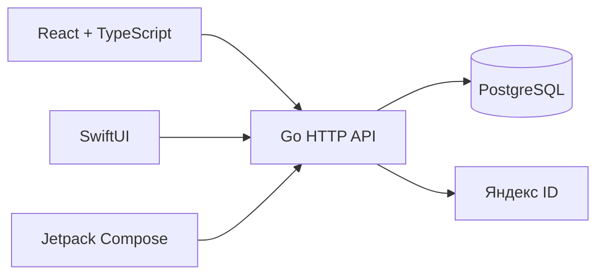

# Design

## Context

19 октября 2026 года. В репозитории есть инструкции, семь delta specs и
одобренные [макеты v0.7](ux.md); исполняемых приложений, API и БД пока нет.
Мотивация и полный состав MVP — в [proposal.md](proposal.md). Архитектура
клиентских интерфейсов принята в [ADR 0002](../../../docs/architecture/0002-client-ui.md).

Этот документ предлагает техническое решение. Технологии ниже не установлены
и не проверены сборкой. Пользователь согласовал порядок: **назначенная дата →
создание → приглашение → ответ → чат** на общем бэкенде и трёх клиентах.
Календарь, опрос даты, смена места и задачи остаются последующими этапами MVP.

## Goals / Non-Goals

**Goals:**

- Получить первый сквозной сценарий с реальными аккаунтами и данными.
- Использовать один контракт операций для web, iOS и Android; авторитетные
  права и бизнес-правила проверяет Go-сервер.
- Сохранять изменения встречи и записи истории атомарно, выдерживать повтор
  запроса после потери ответа и конкурентные действия участников.
- Реализовать одобренный UX средствами клиентов с общими смысловыми токенами.

**Non-Goals:**

- Текущая работа создаёт план, а не приложения или рабочий OAuth.
- Первый срез не является выпуском всего MVP. Его приёмка не закрывает требования
  календаря, опросов и задач и не позволяет архивировать всё изменение.
- Поездки, платежи, AI-функции, уведомления ОС и автономная работа без сети
  не добавляются этим техническим решением.

## Decisions

### 1. Один Go-процесс, PostgreSQL и HTTP/JSON

Для реализации предлагаются Go `net/http`, PostgreSQL и драйвер `pgx`.
В `backend/cmd/server` находится точка входа; `internal/identity`,
`internal/meetings`, `internal/feed` содержат предметные операции, обработчики
и адаптеры хранения. Фактические пакеты создаются по мере реализации.
HTTP-слой не управляет транзакцией за бизнес-операцию и не подменяет её права.

PostgreSQL подходит для связанных данных, ограничений уникальности и транзакций
RSVP/ленты. SQLite потребовал бы отдельно решать конкурентную серверную запись;
микросервисы и отдельный брокер добавили бы распределённую согласованность.
На первом срезе в них нет потребности. ORM не нужен: явные SQL-запросы и миграции
хранятся рядом с Go-кодом. Команду миграций реализуем на закреплённом `goose`.

API — HTTP/JSON с префиксом `/api/v1`; описание OpenAPI 3.1 будет находиться
в `contracts/openapi.yaml`. [api.md](api.md) задаёт операции первого среза,
ошибки и примеры до появления машинного контракта. REST выбран вместо GraphQL
и gRPC: существующий путь состоит из небольшого набора операций, общих для
браузера и мобильных клиентов, без отдельного шлюза.

Общий API передаёт встречи, ответы и записи ленты. Их типы описывают предметные
данные; дерево UI, имена клиентских компонентов и переходы сервер не присылает.

### 2. Модели и ограничения первого среза

| Модель | Основные поля | Ограничение и назначение |
| --- | --- | --- |
| `User` | `id`, `display_name`, `created_at` | Внутренний UUID; имя не является идентификатором входа. |
| `ExternalIdentity` | `provider`, `subject`, `user_id` | UNIQUE `(provider, subject)`; для Яндекса используется проверенный сервером `id`, не email. |
| `Session` | `id`, `user_id`, `secret_hash`, `client_kind`, `expires_at`, `revoked_at` | Одна сессия на вход/устройство; в БД нет открытого секрета сессии. |
| `AuthAttempt` | `id`, `state_hash`, `context`, `client_kind`, `status`, `expires_at` | Этапы `pending / provider_verified / session_issued`, отдельные отметки погашения state и кода передачи; подробности в [auth.md](auth.md). |
| `Meeting` | `id`, `organizer_id`, `title`, `description`, `starts_at`, `timezone`, `place`, `revision`, `feed_sequence`, `created_at` | Название и известное время обязательны; описание и текстовое место могут отсутствовать. |
| `InvitationLink` | `id`, `meeting_id`, `token`, `created_at` | Непредсказуемые 32 случайных байта в URL-safe формате; UNIQUE токен. В первом срезе одна ссылка на встречу. |
| `Rsvp` | `meeting_id`, `user_id`, `answer`, `revision`, `updated_at` | UNIQUE `(meeting_id, user_id)`; `going / maybe / not_going`. Отсутствие строки означает отсутствие ответа. |
| `FeedEntry` | `id`, `meeting_id`, `sequence`, `kind`, `actor_id`, `occurred_at`, `payload` | UNIQUE `(meeting_id, sequence)`; событие или сообщение с версией payload. |
| `RequestReceipt` | `user_id`, `operation`, `key`, `request_hash`, `resource_id`, `expires_at` | UNIQUE по пользователю, операции и ключу; защита от дублей при повторе. |

Связи: пользователь владеет встречами и ответами; у встречи есть ссылка, ответы
и лента. Организатор хранится отдельно от ответов приглашённых. Состав компании —
организатор и уникальные пользователи с текущим `going`; число не хранится
вручную в нескольких таблицах. Сам организатор не присоединяется по своей ссылке.
Выход организатора и передача владения не входят в первый путь.

Для создания Meeting дополнительно хранит `client_request_id` и исходный
`creation_request_hash`: повтор сравнивается с исходным запросом, даже если
организатор впоследствии изменил настройки. У сообщения постоянная уникальность
запроса задаётся `(meeting_id, actor_id, client_request_id)`.

Время хранится как UTC instant (`timestamptz`) вместе с IANA timezone встречи.
Клиент передаёт явно выбранные дату, время, зону и смещение; сервер проверяет
согласованность. Для неоднозначного или отсутствующего местного времени нужен
явный выбор/ошибка поля, а не молчаливый перенос на час. Календарные дни клиента
не вычисляются простым обрезанием UTC-строки.

Ответ API с первого среза допускает `starts_at: null` для будущих встреч
с выбором даты; клиенты проверяются на таком fixture и не выдумывают дату.
Само создание первого среза требует назначенного времени. Это позволяет позднее
добавить опрос даты без падения уже выпущенных декодеров; серверная модель
недатированной встречи расширяется на соответствующем этапе.

Будущие `PlacePoll`, `PlaceVote`, `PreparationTask`, варианты даты и обложки
имеют отдельные модели. Их таблицы не создаются пустыми заранее. Известные
правила и оставшиеся условия следующих этапов перечислены ниже.

### 3. Права и транзакции

Согласовано пользователем: настройки меняет организатор; участники видят состав
и ответы друг друга; смена `going` на `maybe / not_going` закрывает чат.
Публичная ссылка не является правом читать переписку.

| Операция | Кто может выполнить |
| --- | --- |
| Прочитать публичное приглашение | Обладатель действительной ссылки; только разрешённые публичные поля. |
| Создать встречу | Пользователь с действующей сессией. |
| Сохранить свой RSVP | Авторизованный приглашённый, доказавший знание ссылки, либо пользователь с собственным ранее сохранённым ответом. |
| Прочитать детали, состав и чужие ответы | Организатор или пользователь с текущим `going`. |
| Читать и писать ленту | Организатор или пользователь с текущим `going`; проверка при каждом запросе. |
| Изменить настройки | Организатор; `revision` защищает от перезаписи устаревшей формы. |

Создание в одной транзакции сохраняет встречу, ссылку, запись `meeting_created`
и receipt запроса. Сохранение RSVP блокирует строку встречи, сверяет права
и ожидаемую ревизию ответа, затем сохраняет ответ и событие изменения.
Повтор того же ответа ничего не меняет и не создаёт ещё одно присоединение.
Переход в `going` отражается как `participant_joined`; выход из него — как
`participant_left`; прочее изменение — `rsvp_changed`. Ответы `maybe/not_going`
не увеличивают состав компании. Пользователь может повторно выбрать `going`.

Отправка сообщения, изменение настроек и изменение RSVP используют один порядок
блокировки встречи. Это не позволяет конкурентной отправке обойти уже
сохранённую потерю доступа. Успех операции означает commit; потерянный сетевой
ответ не отменяет уже сохранённое действие. Идемпотентность не отменяет повторную
проверку текущего доступа перед выдачей результата.

### 4. Яндекс ID и собственные сессии

Выбран серверный обмен authorization code и собственная сессия Somewhere.
Яндекс-токен используется сервером для проверки личности и не становится
ключом доступа к нашему API. Подробная последовательность, возврат к приглашению,
cookie/Bearer, отмена и повтор — в [auth.md](auth.md).

Так один путь проверки личности обслуживает три клиента. Браузер использует
защищённую cookie; мобильные приложения — системный браузер и защищённое хранение
сессии. Альтернативы: отдельные LoginSDK на обеих платформах либо внешний
посредник авторизации. Они добавляют интеграции, которые не нужны для первого
провайдера. Серверный путь требуется проверить с реальным приложением Яндекс OAuth
на всех трёх клиентах до объявления входа готовым.

### 5. Лента с устойчивым порядком и догрузкой

`FeedEntry` — журнал пользовательских сообщений и предметных событий, не event
sourcing всей системы. Текущее состояние остаётся в таблицах встречи и ответов;
история содержит снимок изменения, а не ссылку на изменяемый текущий текст.

При записи под блокировкой встречи увеличивается `feed_sequence`; запись
получает следующий номер в той же транзакции. Время и глобальный `BIGSERIAL`
не используются как единственный курсор: конкурентная транзакция не должна
поздно сохранить запись, которую клиент уже пропустил. Удаление сообщения
не входит в первый срез; номера ленты повторно не используются.

Последние записи загружаются страницей; новые — по `after_sequence`, история —
по `before_sequence`. Для каждой догрузки проверяется доступ. Ответ содержит
текущую ревизию встречи, свой RSVP и счётчик состава, чтобы данные рядом с лентой
обновлялись вместе с наблюдаемыми событиями. Клиент сливает данные по ID/sequence,
сохраняет позицию при чтении истории и не прыгает вниз при каждом ответе.

Первая доставка — опрос HTTP каждые 3 секунды при открытой активной встрече;
при ошибке интервал увеличивается до 30 секунд, в фоне опрос останавливается.
Возврат на экран сразу догружает новые записи. Интервалы — настройки первого
среза, не обещание мгновенной доставки. WebSocket/SSE потребовали бы отдельного
восстановления соединений и контроля отозванного доступа. Их можно добавить
позже, сохранив журнал и курсоры HTTP.

Сообщение показывается локально как отправляемое с `client_request_id`.
Неопределённый исход повторяется с тем же ID; черновик не теряется. При потере
доступа клиент закрывает разговор и очищает его кеш. Это предотвращает дальнейшее
чтение в приложении, но не отзывает уже сделанные снимки или прочитанное человеком.

### 6. Реализация клиентов и связь с UX

| Часть UX v0.7 | API и состояние | Клиентская реализация |
| --- | --- | --- |
| Онбординг и вход | Сессия, `AuthAttempt`, сохранённая точка входа | Общий вход; приглашение обходит онбординг. |
| Личные встречи | `GET /meetings`, загрузка/пусто/ошибка | Сначала список; календарь добавляется следующим этапом к тем же данным. |
| Создание | `POST /meetings`, локальный черновик и ID запроса | Форма, сохранение, повтор, подтверждение выхода с несохранённым вводом. |
| Передача ссылки | Ссылка из результата или API организатора | Web Clipboard с ручным копированием; системное Share в мобильных клиентах. |
| Приглашение и ответ | Публичный preview, собственный RSVP | Три ответа; чат открывается только после ответа API. |
| Лента и информация | Детали, участники, страница записей, локальная отправка | Сообщения, системные события, компактная шапка; на телефоне одна колонка. |

Веб: Vite, React + TypeScript, React Router для маршрутов и TanStack Query для
серверного кеша. Формы и небольшое UI-состояние — локальные хуки; дополнительный
глобальный store не нужен. Автоповторы мутаций выключены: явный повтор использует
сохранённый ключ запроса. Все конфигурации приложения — TypeScript.

FSD: `app` связывает маршруты, провайдеры и QueryClient; `pages` содержит экраны
landing, meetings, meeting-create, invitation, meeting и auth-return;
`widgets` — самостоятельную композицию ленты/деталей;
`features` — sign-in, create-meeting, respond-to-invitation, send-message,
share-invitation и edit-meeting; `entities` — user, meeting, rsvp, feed-entry;
`shared` — независимые UI, transport, примитивы контрактов и config.
DTO маппятся в предметных slices; features не импортируют друг друга.
Файл компонента содержит только импорты, компонент и Props, ориентир —
до 100 содержательных строк. Все внутренние импорты идут через `@/` и публичные API.

iOS: SwiftUI, владельцы состояния на `MainActor`, `URLSession` + `Codable`,
`ASWebAuthenticationSession` для входа, Keychain для сессии. Навигация и черновик
формы принадлежат приложению; сетевые задачи отменяются по жизненному циклу.

Android: Compose, ViewModel + StateFlow, Repository и coroutines, OkHttp +
kotlinx.serialization для сети; системная авторизация через Custom Tabs.
Секрет сессии шифруется ключом Android Keystore и хранится в закрытой области
приложения. Сбор состояния учитывает жизненный цикл; Back не теряет приглашение.

Точные версии и toolchain закрепляются при инициализации в lock-файлах,
Go module, Xcode project и Gradle version catalog; плавающих зависимостей нет.
Предлагаемый минимум для пет-проекта — iOS 17 и Android API 26. Совместимость
выбранных стабильных SDK с этим минимумом проверяется сборкой при инициализации.
Рекомендации не означают, что Xcode, Android SDK или команды сборки уже настроены.

### 7. Последующие этапы того же MVP

| Этап | Известное решение | Что требуется до его реализации |
| --- | --- | --- |
| Календарь и история | Один набор личных встреч в списке и календаре; недатированные отдельно. | Определить границу «прошедшей» встречи и права после завершения; закончить UX этих границ. |
| Опрос даты | Варианты предлагает организатор; итоговое время выбирает он. | Дополнить delta specs и UX голосования, связь с RSVP/доступом к чату и правила изменения вариантов. |
| Смена места | Автор задаёт срок; автозакрытие; один открытый опрос; голос можно менять; без кворума; ничья/0 не меняют место. | Определить учёт пришедших/вышедших и ручного изменения места во время опроса; закрыть соответствующие сценарии. |
| Подготовка | Предложение адресату и отдельное принятие; состояние видно в ленте. | Решить принятие чужой задачи, отказ/передачу/отмену и необходимость завершения; дополнить UX. |
| Обложка | Необязательна, принадлежит встрече. | Выбрать хранение, ограничения загрузки и обработку ошибок; реализовать до выпуска полного MVP. |

Для автозакрытия опросов планируется фоновый цикл в том же Go-приложении:
просроченный открытый опрос выбирается и закрывается под блокировкой, результат,
место и записи ленты сохраняются одной транзакцией. Перезапуск догоняет
просроченные опросы; повтор цикла не применяет результат дважды. Это не зависит
от того, открыт ли у кого-нибудь экран. Точная транзакция уточняется после
перечисленных продуктовых решений, до кода этапа.

### 8. Проверка и совместимость

OpenAPI и общие JSON-fixtures проверяют запросы, ответы, nullable, ошибки и типы
записей во всех клиентах. DTO и transport остаются внутри приложений; общий
исполняемый UI/SDK трёх языков не создаётся. Клиенты терпимы к дополнительным
полям; неизвестный тип записи отображается безопасной заглушкой без исполнения
действий и не ломает остальную историю. Новые обязательные поля/смена семантики
требуют совместимого расширения либо новой версии API.

Серверные integration-тесты используют настоящий PostgreSQL, часы и подставной
OAuth-provider; production-путь не содержит обхода входа. Проверяются гонки
RSVP/сообщения, повтор после commit, приватность публичного DTO, закрытие доступа
и восстановление приглашения. UI сравнивается с [макетами](ux.md) отдельно
на web, iOS и Android; структура OpenSpec не заменяет эти проверки.

## Risks / Trade-offs

- [Три реализации UI] → Общие UX, контракт и сценарии приёмки, отдельная проверка платформ.
- [Задержка обновления при polling] → Догрузка при возврате, устойчивые курсоры; смена транспорта при реальной потребности.
- [Последовательная запись одной встречи] → Короткие транзакции без внешних HTTP-вызовов под блокировкой; измерить задержки до усложнения.
- [OAuth ещё не проверен] → Первый интеграционный этап проверяет весь вход и возврат на трёх платформах с реальным Яндекс OAuth.
- [Часть MVP ещё требует продуктовых решений] → Задачи следующих этапов имеют явные условия старта; их нельзя выполнять по умолчаниям агента.
- [Уже прочитанные сообщения нельзя отозвать] → Прекратить новые запросы и убрать приватный кеш при выходе/потере доступа.

## Migration Plan

Это новый проект: перенос существующих пользовательских данных не требуется.
Локально запускаются PostgreSQL и API; веб обращается к тому же origin через
dev proxy. Для реального OAuth нужен зарегистрированный HTTPS callback,
конфигурация домена и секреты вне Git. Подробности — в [auth.md](auth.md).

Порядок: контракт и окружение → серверный вход/данные/лента → web → iOS → Android
→ проверка одного сценария между всеми клиентами. Это последовательность
поставки, а не отказ от любой платформы. Каждое приложение получает реальные
команды запуска, форматирования, сборки и тестов в своём AGENTS.md.

Миграции БД применяются перед совместимым релизом API. Деструктивная миграция
не совмещается с первым изменением контракта; откат приложения сохраняет схему
и данные. До публичного окружения требуется проверенное восстановление БД
из резервной копии. Выпуск первого среза не равен готовности полного MVP.

## Open Questions

До соответствующей задачи инициализации можно выбрать точные стабильные версии
зависимостей, адрес тестового HTTPS-домена, идентификаторы мобильных приложений
и параметры окружения. Их фиксация не меняет приведённые операции и зависимости.
Продуктовые условия следующих этапов вынесены в раздел 7; это ограничения их
готовности, а не разрешение реализовать неизвестное поведение.

## Sources

Официальные материалы проверены 19 октября 2026 года; выбор для Somewhere сделан
в этом документе, источники не подтверждают работоспособность ещё не созданных приложений.

- [Организация Go-модуля](https://go.dev/doc/modules/layout#server-project), [net/http](https://pkg.go.dev/net/http), [pgx](https://github.com/jackc/pgx), [goose](https://github.com/pressly/goose).
- [PostgreSQL: блокировки строк](https://www.postgresql.org/docs/current/explicit-locking.html), [OpenAPI 3.1.1](https://spec.openapis.org/oas/v3.1.1.html).
- [Vite](https://vite.dev/guide/), [React Router](https://reactrouter.com/start/declarative/installation), [TanStack Query](https://tanstack.com/query/latest/docs/framework/react/overview).
- [SwiftUI: данные](https://developer.apple.com/documentation/swiftui/model-data), [Compose: состояние](https://developer.android.com/develop/ui/compose/state), [Android Keystore](https://developer.android.com/privacy-and-security/keystore).
- [OkHttp](https://github.com/square/okhttp), [kotlinx.serialization](https://github.com/Kotlin/kotlinx.serialization).
