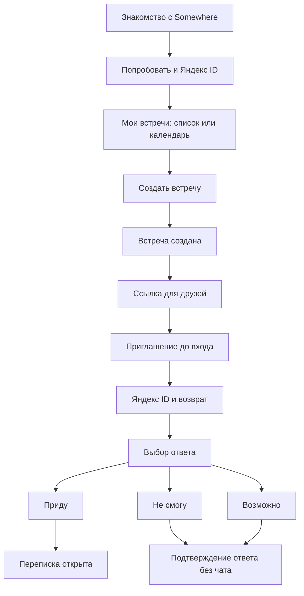

# Создание встречи и ответ друга · UX v0.7

19 октября 2026 года. Направление дизайна v0.6 одобрено пользователем;
в v0.7 применён проектный редактор текстов.
Онбординг и личные встречи добавлены в [entry-home.md](entry-home.md). Это статический UX-пакет, без работающих аккаунтов,
авторизации, копирования ссылки или сохранения данных.

## Результат проверки покрытия

Раньше подробно была подготовлена только лента после присоединения. В v0.5
добавлены недостающие экраны описанного пользователем пути с назначенными датой
и временем, включая принятие и отказ, состояние организатора и основные ошибки.

| Шаг | Было в v0.4 | Покрытие v0.5 |
| --- | --- | --- |
| Первый вход и профиль | Только продуктовый текст | [Онбординг](assets/entry-landing.html), [вход](assets/entry-login.html), возврат и ошибка |
| Пользователь вошёл, встреч ещё нет | Не было | [Пустой список](assets/flow-home-empty.html) |
| Создать встречу | Не было | [Форма](assets/flow-create.html), обязательное название, сохранение, ошибки и выход |
| Встреча создана | Только поздний пример ленты | [Подтверждение](assets/flow-created.html), [лента организатора](assets/flow-owner-feed.html), [список](assets/flow-home.html) |
| Отправить ссылку | Только продуктовый текст | [Отправка приглашения](assets/flow-share.html), копирование и ошибка |
| Друг видит приглашение | Не было | [Приглашение до входа](assets/flow-invite.html) и недоступная ссылка |
| Друг входит | Не было | [Яндекс ID](assets/flow-invite-auth.html), возврат к встрече, ошибка и отмена |
| Друг принимает или отклоняет | Не было | [Выбор ответа](assets/flow-rsvp.html), «Приду», «Возможно», «Не смогу», отправка и ошибка |
| После «Приду» | Только пример большой компании | [Подтверждение](assets/flow-rsvp-accepted.html), [разговор](assets/flow-friend-feed.html), два участника |
| После «Не смогу» | Не было | [Подтверждение отказа](assets/flow-rsvp-declined.html), без перехода к переписке |
| Что видит организатор | Только принятие в большой компании | [Друг принял](assets/flow-owner-accepted.html) / [не сможет](assets/flow-owner-declined.html) |
| Общий чат, смена места, задачи | Были | [Существующие макеты v0.4](assets/feed-index.html) сохранены |

У описанного основного пути нет ненарисованных шагов между созданием встречи,
передачей ссылки и ответом друга. Это не утверждение о готовности всего MVP:
ветка согласования времени, изменение уже принятого ответа, отмена встречи
и ошибки операций внутри ленты ещё требуют дальнейшей проработки.

## Путь в макетах

[Начать с уже вошедшего организатора](assets/flow-home-empty.html) ·
[первый вход](assets/flow-welcome.html) · [начать с приглашения друга](assets/flow-invite.html) ·
[обзор пути создания](assets/journey-index.html).

Организатор в примере — Саша, друг — Лена. Это одна встреча с одинаковыми
названием, датой и местом во всех шагах: 24 октября 2026 года, 19:00 по Москве,
лофт «Квартал». До первого «Приду» в ней один организатор; после принятия — двое.
Поздние состояния ленты v0.4 с пятью участниками — отдельные демонстрационные
снимки, а не продолжение изменяемых данных в этом прототипе.

## Подтверждённые решения

- До входа по ссылке показываются название, дата и место приглашения.
- Для сохранения ответа нужен Яндекс ID. Уже вошедший друг попадает на выбор
  ответа без повторной авторизации.
- После входа открывается именно исходная встреча. Первый вход создаёт профиль
  без дополнительной анкеты; сам вход не означает согласие прийти.
- Переписка открывается после успешно сохранённого «Приду». До этого, в том числе
  после первого «Возможно» или «Не смогу», макет её не показывает.
- «Не смогу» подтверждает отказ и не выглядит вступлением в компанию.

Первый, второй и четвёртый пункты уточнены с пользователем в этой итерации;
Яндекс ID, автоматический профиль и три варианта ответа уже входили в MVP.
Требования находятся в [meeting-creation](specs/meeting-creation/spec.md) и
[invitation-rsvp](specs/invitation-rsvp/spec.md).

## Формы, ошибки и возвраты

В форме есть необязательная обложка именно этой встречи. Фото в заполненном
примере уже выбрано пользователем; это не стандартная картинка новых встреч.
На входе и в пустом списке обложки нет. Аватары — отдельные данные профиля;
в макетах показан вариант с инициалами. Есть отдельный
[вид приглашения без обложки](assets/flow-invite-no-cover.html).
Выбор файла показан нативным полем браузера, но загрузка и обновление превью
в статическом прототипе не выполняются.

| Ситуация | Макет и ожидаемое поведение |
| --- | --- |
| Нет названия | [Ошибка поля](assets/flow-create-error.html); форма остаётся открытой |
| Встреча сохраняется | [Ожидание](assets/flow-create-saving.html); не создавать повторно |
| Ошибка создания | [Повтор](assets/flow-create-save-error.html); введённое не теряется |
| Выход из заполненной формы | [Предупреждение](assets/flow-create-discard.html); продолжить либо выйти |
| Ссылка скопирована | [Успех](assets/flow-share-copied.html) |
| Копирование не удалось | [Ошибка](assets/flow-share-error.html); доступно ручное выделение ссылки |
| Первый вход не удался | [Ошибка входа](assets/flow-login-error.html) |
| Вход по приглашению не удался | [Ошибка](assets/flow-invite-auth-error.html); приглашение сохранено |
| Вход отменён | [Возврат](assets/flow-invite-auth-cancelled.html) без потери приглашения |
| Ответ отправляется | [Ожидание](assets/flow-rsvp-saving.html); чат ещё закрыт |
| Ответ не сохранился | [Ошибка](assets/flow-rsvp-error.html); повтор, без ложного подтверждения |
| Приглашение недоступно | [Состояние ссылки](assets/flow-invite-unavailable.html), без раскрытия чата |

Сохранение черновика при ошибке, подтверждение выхода из заполненной формы,
смена первого «Не смогу»/«Возможно» — UX-предложения.
Механизм отзыва ссылки, срок её жизни и отмена события этими макетами не определены.
Изменение «Приду» после вступления и последующие права доступа остаются открытыми.

## Ветка выбора даты

[Настройка](assets/flow-create-dates.html), [созданная встреча](assets/flow-dates-created.html)
и [приглашение с вариантами](assets/flow-invite-dates.html) показывают только эскиз.
Нужно отдельно закончить выбор вариантов гостем, итоговое решение организатора
и связь этих действий с RSVP и доступом к переписке. Основной путь v0.5 использует
дату, известную при создании, и не решает эти вопросы незаметно.

## Web, iOS и Android

Состав полей, смысл переходов и правило доступа общие. На телефоне форма занимает
одну колонку, действия отправки приглашения открываются снизу. На широком экране
есть навигация и пример приглашения рядом с формой. Ошибки объясняются текстом.

Экран Яндекс ID принадлежит провайдеру и не имитируется: показаны только входная
точка Somewhere и возврат. Для нативных оболочек нужны системная авторизация,
прямые ссылки, безопасный возврат к приглашению, системный Back и клавиатура.
Для web нужны аналогичный возврат, восстановление контекста и управление фокусом.
Реальные платформенные интеграции в этом пакете не проверены.

## Как устроена демонстрация

Это HTML/CSS без JavaScript. Ссылки переключают подготовленные состояния;
форма применяет встроенную проверку обязательного названия и переходит к
статическому примеру. Изменённые поля не переносятся в отображаемые данные
следующей страницы. Поля в примерах ошибок заполнены заранее, а не восстановлены
из реального хранилища. Сообщения, ответы, копирование и Яндекс ID не работают.

Кнопка «Продолжить» в состояниях ожидания нужна только для просмотра; приложение
перейдёт дальше после результата операции. Ни один шаг макета не отправляет
сообщение другу и не вызывает реальную авторизацию.

Проверки и ограничения записаны в [verification.md](verification.md).
