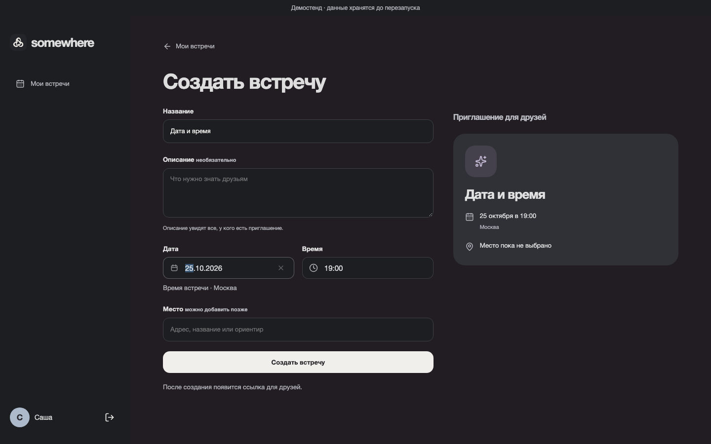
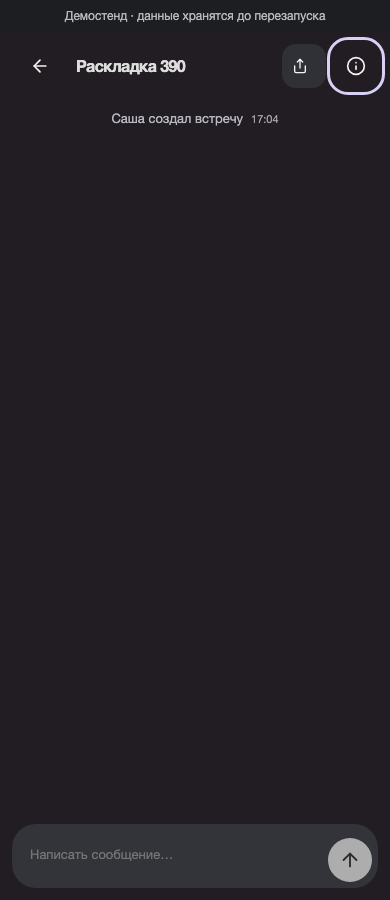
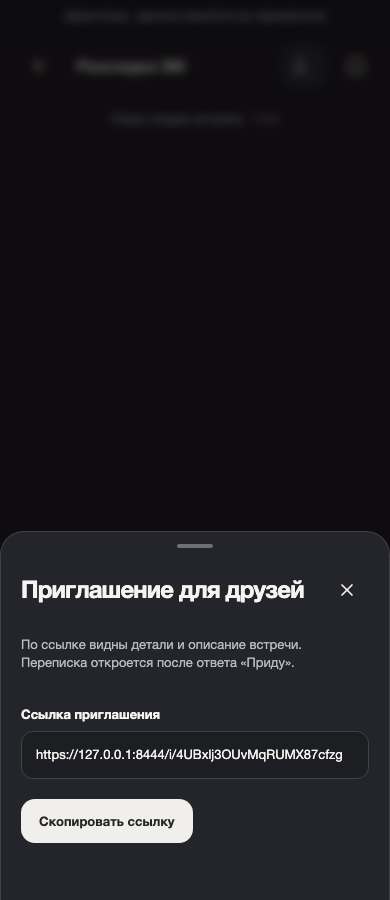

# Каталоги компонентов веба — проверка 5.18

20 октября 2026 все 50 React-компонентов переведены в одноимённые каталоги.
46 компонентов имеют собственный CSS Module; четыре компонента-композиции
без собственных классов не получили пустых стилей. В каждом каталоге один
TSX, собственные стили при необходимости, `index.ts`, личные `hooks/lib/utils`.
Доменные API, модели и публичные API slices сохраняют границы FSD.

Пример — `frontend/web/src/entities/meeting/ui/MeetingCard/`:
`MeetingCard.tsx`, `MeetingCard.module.css`, `index.ts`.
Шапка встречи выделена в отдельный `MeetingHeader`, чтобы компоненты оставались
небольшими. Компактные варианты логотипа и приглашения передаются пропсами.

Общие `conversation.css`, `workspace.css`, `landing.css`, `dialog.css` и
`gravity.css` удалены. Тема Gravity теперь принадлежит `App`, раскладка и
анимации — своим компонентам. В глобальных файлах остались токены, reset,
типографика, базовое оформление HTML-контролов и reduced motion.
Селекторы Gravity разрешены только внутри локального класса CSS Module.

Автоматическая проверка отклоняет несовпадающие имена, соседний компонент,
другой файл стилей, код вместо реэкспорта в `index.ts`, импорт чужих стилей,
глобальные классы JSX, ссылки на отсутствующие CSS-классы и утечки селекторов.
В браузерных тестах используются семантические роли и устойчивые test IDs,
поэтому проверки не зависят от суффиксов CSS Modules.

## Результаты

- `npm run web:check`: TypeScript, ESLint, CSS/FSD/AST и Prettier прошли;
  Vitest — 34 теста в 9 файлах, без пропусков.
- `npm run web:test:e2e`: 23 сценария Chromium с настоящим Go API прошли.
  Создание, вход через test-only provider, приглашение, три ответа, чат,
  повтор/история/отзыв доступа, настройки, короткая ссылка и метатеги сохранены.
- Вёрстка, клавиатура, шапка, единичные действия, диалоги и reduced motion
  проверены на 320/390/768/1440 px; поля даты и времени — на 320/390/1440 px.
- Production-сборка прошла в отдельном временном каталоге, demo build остался
  в `frontend/web/dist`. Живой Go-процесс не перезапускался, данные не сбрасывались.
- `npm run agent:check`, строгая валидация OpenSpec и `git diff --check` прошли.

Просмотрены снимки онбординга, форм и встречи. Примеры после рефакторинга:

Реальный OAuth и внешнее превью в мессенджерах не проверялись: их подключение
отложено. Задача меняет организацию веб-кода, а не продуктовый сценарий или API.
