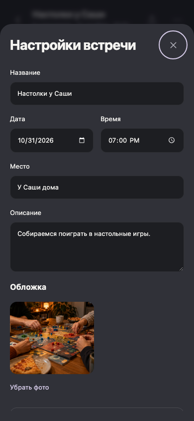
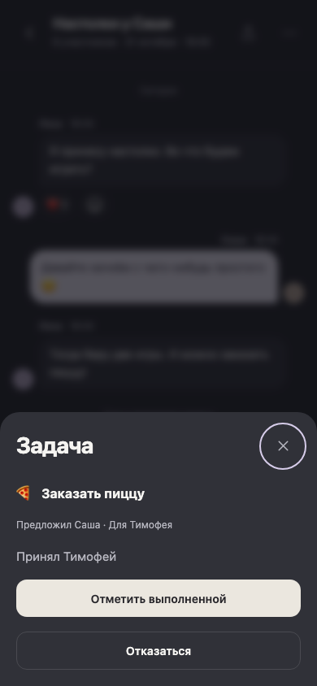
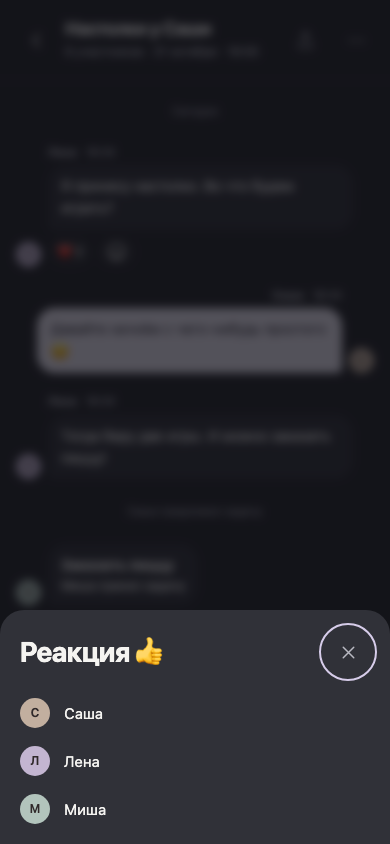

# Отклонённые композиции · 27.10.2026

**REJECTED.** Пользователь считает эти варианты неудобными. Дальнейший дизайн
ориентируется на Telegram, особенно на emoji, и готовится отдельно. Снимки ниже
сохранены для истории, не для повторного согласования или публикации.

Черновики, не опубликованные эталоны. Поведение и права взяты из требований;
выбор касается расположения существующих полей и действий внутри панели.
Проверка HTML описана в [inspection.md](inspection.md).

## Настройки встречи

Название, дата/время, место и описание, затем обложка и Отмена/Сохранить.
Короткий [макет](settings.html); снимки [верхней части](renders/run04/settings-390x844-initial.png),
[действий](renders/run04/settings-390x844-actions.png),
[desktop](renders/run04/settings-1440x1000-initial.png).

В кадре нативный HTML input показывает формат хоста `10/31/2026` / `07:00 PM`.
Согласование композиции не меняет русскую локализацию и контракт календаря продукта.

## Подробности задачи

Название, автор/адресат, состояние, затем доступные текущей роли действия.
Короткие макеты: [предложена](task-offered.html), [принята](task-accepted.html),
[действия организатора](task-organizer.html). Состояния отказа, выполнения и отмены
сохраняют сведения, но не предлагают новых действий.

## Люди по реакции

Выбранная реакция в заголовке, ниже аватар и имя. Контактов, CTA и перехода
в чужой профиль нет. [Макет](reaction-people.html).

